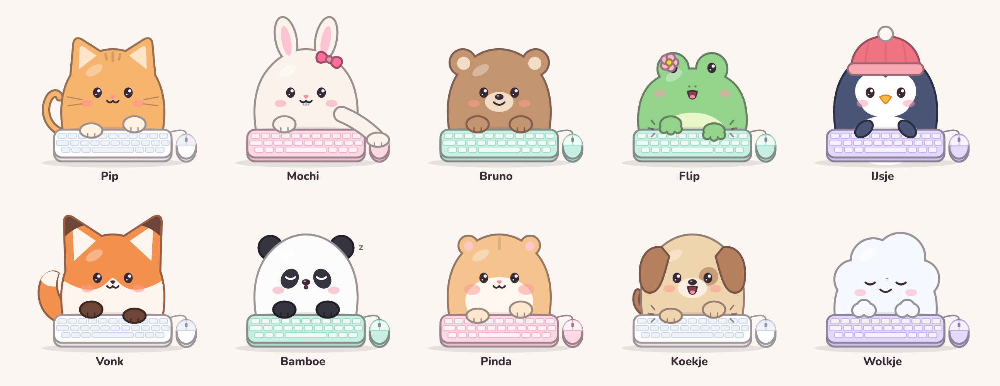
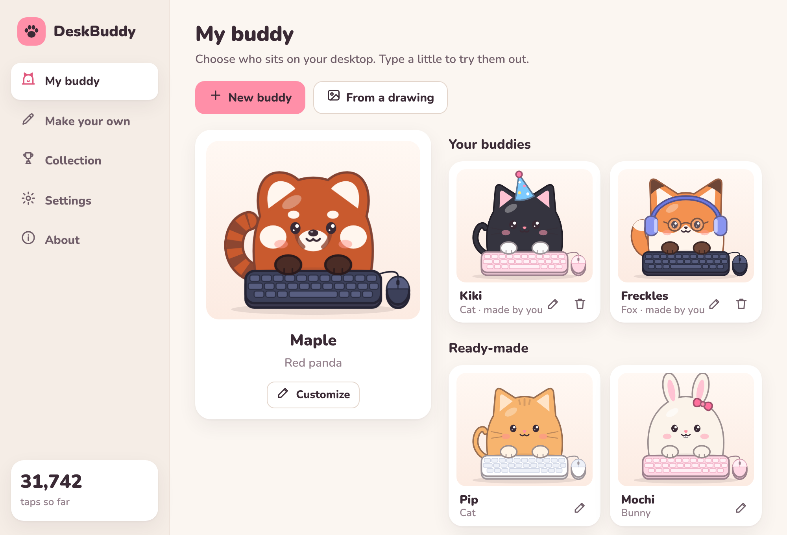
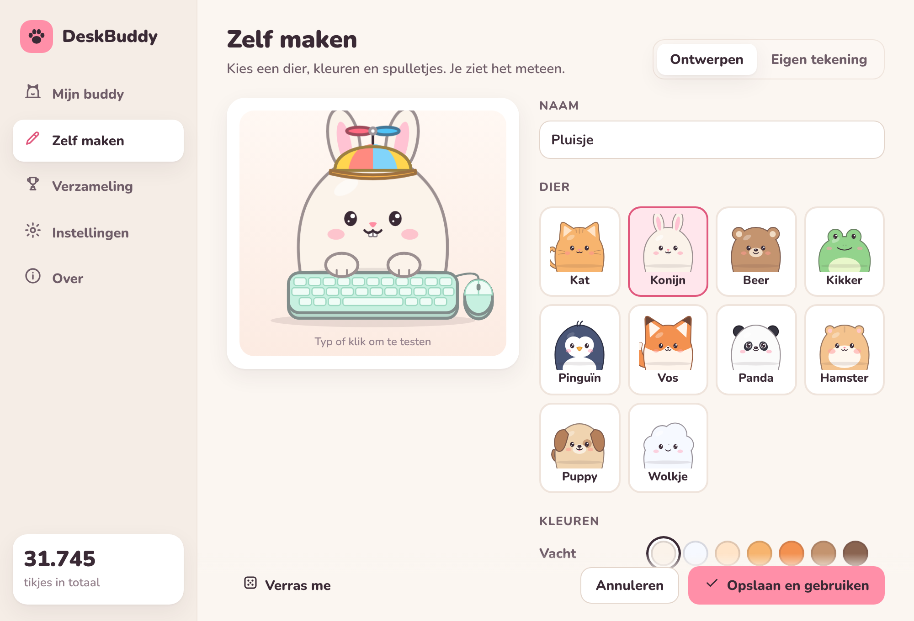

# DeskBuddy

Een klein maatje op je bureaublad dat meetikt als jij typt of klikt.
Voor **Mac en Windows**, zonder Steam, zuinig, en wat je typt blijft van jou.



- **Tikt mee**: toetsen links op je toetsenbord → linkerpootje, rechts → rechterpootje,
  spatiebalk → allebei, klikken → pootje op het muisje. Typ je snel, dan wordt hij er helemaal blij van.
- **Tien buddy's** om uit te kiezen: kat, konijn, beer, kikker, pinguïn, vos, panda, hamster, puppy en een wolkje.
- **Zelf maken**: kies een dier, kleuren, oogjes, mondje, hoedjes, brilletjes en een toetsenbord.
  Of gebruik **je eigen tekeningen** (of een foto van je huisdier).
- **Verdienen**: elke toets en klik telt. Bij 1.000, 5.000, 25.000 … tikjes verdien je nieuwe spulletjes,
  tot een gouden toetsenbord bij een miljoen.
- **Rustig**: geen meldingen, geen winkel, geen vriendenlijst. Na een tijdje niets doen valt hij in slaap.
- **Spookmodus**: klikken gaan dwars door je buddy heen, zodat hij nooit in de weg zit.

| Je buddy kiezen | Zelf maken | Verzameling |
| --- | --- | --- |
|  |  |  |

## Installeren

Download de nieuwste versie:

1. Ga op GitHub naar het tabblad **Actions** en klik op de bovenste run met een groen vinkje.
2. Onderaan bij **Artifacts** staat `DeskBuddy-macOS` en `DeskBuddy-Windows`. Download de jouwe en pak het zipje uit.

(Staat er een versie bij **Releases**? Dan kun je hem ook daar downloaden.)

### Mac

1. Open `DeskBuddy_…_universal.dmg` en sleep **DeskBuddy** naar de map **Applications** (Programma's).
   Werkt op Macs met een Apple-chip én op oudere Intel-Macs.
2. De eerste keer zegt macOS dat het de app niet kan controleren. Dat komt doordat DeskBuddy niet
   ondertekend is met een (betaald) Apple-ontwikkelaarsaccount. Zo open je hem toch:
   - Probeer DeskBuddy één keer te openen en klik het venster weg.
   - Ga naar **Systeeminstellingen › Privacy en beveiliging**, scroll naar beneden en klik bij DeskBuddy op **Open toch**.
   - Of in Terminal: `xattr -dr com.apple.quarantine /Applications/DeskBuddy.app`
3. macOS vraagt toestemming om toetsaanslagen te zien. Zet DeskBuddy aan bij
   **Systeeminstellingen › Privacy en beveiliging › Invoermonitoring** en kies daarna **Stop en open opnieuw**.
   Zonder deze toestemming ziet DeskBuddy alleen je klikken.
4. DeskBuddy woont in de **menubalk** (het pootje bovenaan je scherm), niet in het Dock.

> Na het installeren van een nieuwe versie moet je DeskBuddy soms opnieuw aanzetten bij Invoermonitoring
> (eerst uit, dan weer aan). Ook dat komt doordat de app niet betaald ondertekend is.

### Windows

1. Start `DeskBuddy_…_x64-setup.exe`. Je hebt geen beheerdersrechten nodig.
2. Krijg je een blauw venster **"Windows heeft uw pc beschermd"**? Klik op **Meer informatie** en dan
   **Toch uitvoeren**. Ook dit komt doordat de app niet ondertekend is met een betaald certificaat.
3. DeskBuddy staat in het **systeemvak** rechtsonder (misschien achter het pijltje ^).
   Klik op het pootje voor de instellingen, rechtsklik voor het menu.

Liever een `.msi`? Die zit ook in het zipje.

## Gebruiken

- **Slepen** verplaatst je buddy. Hij onthoudt zijn plekje, ook na een herstart.
- **Klikken** op je buddy vindt hij leuk.
- **Dubbelklikken** opent de instellingen, **rechtsklikken** geeft een snelmenu.
- Staat hij in de weg? Zet **Spookmodus** aan (in het menu of de instellingen). Uitzetten doe je via het
  pootje in de menubalk of het systeemvak.
- Bij **Instellingen** kun je hem groter of kleiner maken, doorzichtiger, laten slapen,
  de muis aan de linkerkant zetten en DeskBuddy laten **starten bij inloggen**.

## Zelf buddy's maken

Open de instellingen en kies **Zelf maken**.

**Ontwerpen**: kies een dier en speel met de kleuren en spulletjes. Je ziet hem meteen meetikken.
Een kant-en-klare buddy aanpassen kan ook: dan maak je er je eigen versie van. "Verras me" verzint er een voor je.

**Eigen tekening**: maak plaatjes in een tekenprogramma (of gebruik foto's):

| Plaatje | Wanneer | Nodig? |
| --- | --- | --- |
| Gewoon | als je niets doet | ja |
| Linkerpootje | bij toetsen links op je toetsenbord | nee |
| Rechterpootje | bij toetsen rechts en bij klikken | nee |
| Allebei | bij de spatiebalk | nee |
| Slapend | als hij een dutje doet | nee |

Tips: sla ze op als **PNG met een doorzichtige achtergrond** en maak ze allemaal even groot,
dan springt hij niet heen en weer. Eén plaatje is al genoeg: dan wipt hij mee met elke toets.
Grote plaatjes worden automatisch kleiner gemaakt; een bewegende GIF (tot 2 MB) blijft bewegen.

## Verdienen

| Tikjes | Je verdient |
| ---: | --- |
| 1.000 | Feesthoedje |
| 2.500 | Hartjesbril |
| 5.000 | Koptelefoon |
| 10.000 | Ronde bril |
| 25.000 | Propellerpet (draait als je snel typt) |
| 50.000 | Zonnebril |
| 100.000 | Kroontje |
| 250.000 | Tovenaarshoed |
| 500.000 | Regenboog-toetsenbord |
| 750.000 | Aureool |
| 1.000.000 | Gouden toetsenbord |

## Privacy

DeskBuddy telt alleen **hoeveel** toetsen en klikken je doet, en of een toets links of rechts op je
toetsenbord zit (voor het juiste pootje). **Welke** toets je indrukt wordt nooit doorgegeven of bewaard,
en DeskBuddy maakt geen verbinding met internet. Bekijk het zelf in
[`src-tauri/input`](src-tauri/input/src): daar komt alleen "links", "rechts" of "spatie" uit.

Alles wat DeskBuddy onthoudt staat in één mapje op je eigen computer:

- Mac: `~/Library/Application Support/io.github.vr0em.deskbuddy/`
- Windows: `%APPDATA%\io.github.vr0em.deskbuddy\`

Daarin staan `settings.json`, `stats.json` (je tellers) en `buddies.json` (je eigen buddy's).
Kopieer dat mapje als je je tellers wilt bewaren of meenemen naar een andere computer.

## Waarom het zuinig is

- Geen Steam en geen eigen browser: DeskBuddy gebruikt de webweergave die al in je systeem zit
  (WebView2 op Windows, WebKit op de Mac). De download is maar een paar megabyte.
- Het luisteren naar je toetsenbord gebeurt in een klein stukje Rust-code dat alleen een seintje geeft.
- De buddy tekent alleen iets nieuws als er iets verandert. Zet **Levendig** uit en hij beweegt
  helemaal alleen nog als jij iets doet.

## Problemen?

- **Mac: hij tikt niet mee als ik typ.** Zet DeskBuddy aan bij *Systeeminstellingen › Privacy en beveiliging ›
  Invoermonitoring* en start hem opnieuw. Staat hij er al aan (bijvoorbeeld na een nieuwe versie)? Zet hem uit en weer aan.
- **Windows: hij tikt niet mee in één bepaald programma.** Programma's die als administrator draaien,
  schermt Windows af. In die vensters ziet DeskBuddy je toetsen niet.
- **Buddy kwijt?** Kies *Terug naar de hoek* in het menu bij het pootje (menubalk of systeemvak).
- **Hij staat in de weg bij klikken?** Zet *Spookmodus* aan.

## Zelf bouwen

Voor wie zelf aan DeskBuddy wil sleutelen. Je hebt nodig:
[Rust](https://rustup.rs), [Node.js](https://nodejs.org) 20 of nieuwer, en op Windows de
[Microsoft C++ Build Tools](https://visualstudio.microsoft.com/visual-cpp-build-tools/) of op de Mac de
Xcode Command Line Tools (`xcode-select --install`).

```bash
npm install
```

```bash
npm run dev
```

Een installer maken:

```bash
npm run build
```

Alleen het uiterlijk bekijken, zonder de app te bouwen (in je gewone browser):

```bash
npm run preview
```

en open dan http://localhost:5173. Toetsen en klikken in dat tabblad tellen dan als tikjes.

Wil je zien wat de toetsenbord-luisteraar precies oppikt? In de map `src-tauri`:

```bash
cargo run -p deskbuddy-input --example listen
```

Druk dan wat toetsen in en klik een paar keer. Met de omgevingsvariabele `DESKBUDDY_DEBUG=1`
vertelt de app zelf in de terminal wat hij ziet.

### Hoe het in elkaar zit

| Map | Wat |
| --- | --- |
| `src-tauri/input` | Luistert naar toetsenbord en muis: Windows-hooks en macOS-event-taps. Geeft alleen door *dat* er iets gebeurde en aan welke kant. |
| `src-tauri/src` | De app: vensters, menubalk/systeemvak, opslaan van instellingen en tellers. |
| `ui/js/render.js` | Tekent de buddy's als SVG. Hier voeg je nieuwe dieren of hoedjes toe. |
| `ui/js/catalog.js` | Alle dieren, kleuren, spulletjes en wanneer je ze verdient. |
| `ui/js/stage.js` | Laat een buddy bewegen: tikken, knipperen, slapen. |
| `ui/settings.html`, `ui/js/settings.js` | Het instellingenvenster. |
| `ui/buddy.html`, `ui/js/buddy.js` | Het doorzichtige buddy-venster. |
| `dev/gallery.html` | Overzicht van alle buddy's en houdingen (open via `npm run preview`). |

### Een nieuwe versie uitbrengen

1. Verhoog het versienummer in `src-tauri/tauri.conf.json` (en in `package.json` en `src-tauri/Cargo.toml`).
2. Maak een tag en push hem:

   ```bash
   git tag v0.2.0
   ```

   ```bash
   git push origin v0.2.0
   ```

3. GitHub Actions bouwt de installers en zet ze in een concept-release. Publiceer die bij **Releases**.

Het lettertype is [Nunito](https://github.com/googlefonts/nunito) (SIL Open Font License, zie `ui/fonts/OFL.txt`).
