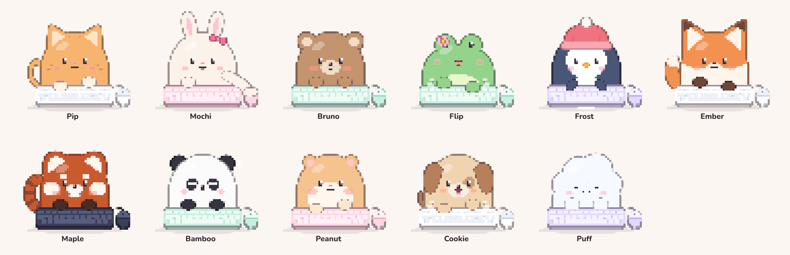
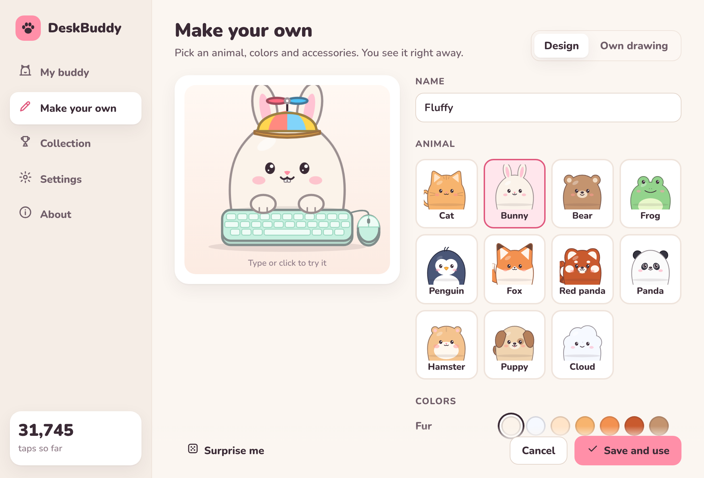
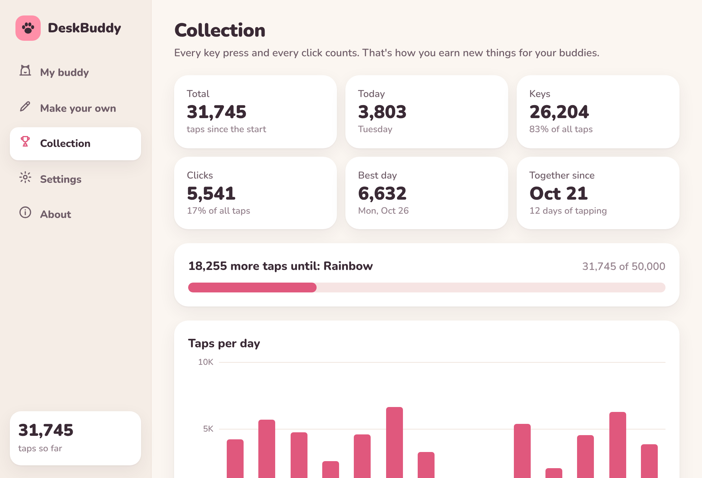

# DeskBuddy

A little companion on your desktop that taps along whenever you type or click.
For **Mac and Windows**, no Steam needed, light on your computer, and what you type stays yours.


- **Taps along**: keys on the left of your keyboard → left paw, on the right → right paw,
  space bar → both, clicks → a paw on the little mouse. Type fast and it gets really excited.
- **Eleven buddies** to choose from: cat, bunny, bear, frog, penguin, fox, red panda, panda, hamster, puppy and a little cloud.
- **Make your own**: pick an animal, colors, eyes, mouth, hats, glasses and a keyboard.
  Or use **your own drawings** (or a photo of your pet).
- **Earn things**: every key press and click counts. Your first hat arrives after just 100 taps,
  all the way up to a golden keyboard.
- **Pixel mode**: turn every buddy, hat and keyboard into chunky retro pixels.
- **Calm**: no notifications, no store, no friends list. After a while without input it falls asleep.
- **Ghost mode**: clicks go straight through your buddy, so it's never in the way.



| Pick your buddy | Make your own | Collection |
| --- | --- | --- |
|  |  |  |

## Install

Download the latest version from the **[Releases page](https://github.com/VR0EM/DeskBuddy/releases/latest)**:

- **Mac** (Apple Silicon and Intel): `DeskBuddy_…_universal.dmg`
- **Windows**: `DeskBuddy_…_x64-setup.exe` (or the `.msi` if you prefer)

### Mac

1. Open the `.dmg` and drag **DeskBuddy** into the **Applications** folder.
2. The first time, macOS says it can't check the app. That's because DeskBuddy isn't signed with a
   (paid) Apple developer account. To open it anyway:
   - Try to open DeskBuddy once and close the message.
   - Go to **System Settings › Privacy & Security**, scroll down and click **Open Anyway** next to DeskBuddy.
   - Or in Terminal: `xattr -dr com.apple.quarantine /Applications/DeskBuddy.app`
3. macOS asks for permission to see key presses. Turn DeskBuddy on under
   **System Settings › Privacy & Security › Input Monitoring**, then choose **Quit & Reopen**.
   Without this permission DeskBuddy only sees your clicks.
4. DeskBuddy lives in the **menu bar** (the paw at the top of your screen), not in the Dock.

> After installing a new version you may have to switch DeskBuddy off and on again under
> Input Monitoring. That's also because the app isn't signed with a paid certificate.

### Windows

1. Run `DeskBuddy_…_x64-setup.exe`. You don't need administrator rights.
2. Seeing a blue **"Windows protected your PC"** window? Click **More info** and then **Run anyway**.
   This is also because the app isn't signed with a paid certificate.
3. DeskBuddy sits in the **system tray** at the bottom right (maybe behind the ^ arrow).
   Click the paw for the settings, right-click it for the menu.

## Using it

- **Drag** to move your buddy. It remembers its spot, even after a restart.
- **Clicking** your buddy makes it happy.
- **Double-click** opens the settings, **right-click** gives a quick menu.
- In the way? Turn on **Ghost mode** (in the menu or the settings). Turn it off again with the
  paw in the menu bar or system tray.
- In **Settings** you can make it bigger or smaller, more see-through, switch on pixel mode, let it
  fall asleep, put the mouse on the left, and let DeskBuddy **start at login**.

## Making your own buddies

Open the settings and choose **Make your own**.

**Design**: pick an animal and play with colors and accessories. You see it tapping right away.
You can also customize a ready-made buddy: that makes your own version of it. "Surprise me" makes one up for you.

**Own drawing**: make pictures in any drawing app (or use photos):

| Picture | When | Needed? |
| --- | --- | --- |
| Normal | when you do nothing | yes |
| Left paw | for keys on the left of your keyboard | no |
| Right paw | for keys on the right and for clicks | no |
| Both paws | for the space bar | no |
| Sleeping | when it takes a nap | no |

Tips: save them as **PNG with a transparent background** and make them all the same size,
so it doesn't jump around. One picture is enough: then it hops along with every key.
Large pictures are made smaller automatically; an animated GIF (up to 2 MB) stays animated.

## Things to earn

| Taps | You earn |
| ---: | --- |
| 100 | Party hat |
| 250 | Heart glasses |
| 500 | Headphones |
| 1,000 | Round glasses |
| 2,500 | Propeller cap (spins when you type fast) |
| 5,000 | Sunglasses |
| 10,000 | Crown |
| 25,000 | Wizard hat |
| 50,000 | Rainbow keyboard |
| 75,000 | Halo |
| 100,000 | Golden keyboard |

## Privacy

DeskBuddy only counts **how many** keys and clicks you make, and whether a key is on the left or the
right of your keyboard (for the right paw). **Which** key you press is never passed on or stored,
and DeskBuddy never connects to the internet. See for yourself in
[`src-tauri/input`](src-tauri/input/src): all that comes out is "left", "right" or "space".

Everything DeskBuddy remembers lives in one folder on your own computer:

- Mac: `~/Library/Application Support/io.github.vr0em.deskbuddy/`
- Windows: `%APPDATA%\io.github.vr0em.deskbuddy\`

It holds `settings.json`, `stats.json` (your counters) and `buddies.json` (your own buddies).
Copy that folder to keep your counters or take them to another computer.

## Why it's light

- No Steam and no bundled browser: DeskBuddy uses the web view that's already part of your system
  (WebView2 on Windows, WebKit on the Mac). The download is only a few megabytes.
- Listening to your keyboard happens in a small piece of Rust code that only sends a signal.
- The buddy only redraws when something changes. Turn **Lively** off and it only moves when you do something.

## Troubleshooting

- **Mac: it doesn't tap when I type.** Turn DeskBuddy on under *System Settings › Privacy & Security ›
  Input Monitoring* and restart it. Already on (for example after a new version)? Switch it off and on again.
- **Windows: it doesn't tap in one particular program.** Windows shields programs that run as
  administrator. DeskBuddy can't see your keys in those windows.
- **Lost your buddy?** Choose *Back to the corner* in the paw menu (menu bar or system tray).
- **In the way when clicking?** Turn on *Ghost mode*.

## Building it yourself

For anyone who wants to tinker with DeskBuddy. You need:
[Rust](https://rustup.rs), [Node.js](https://nodejs.org) 20 or newer, and on Windows the
[Microsoft C++ Build Tools](https://visualstudio.microsoft.com/visual-cpp-build-tools/), or on the Mac the
Xcode Command Line Tools (`xcode-select --install`).

```bash
npm install
```

```bash
npm run dev
```

To make an installer:

```bash
npm run build
```

To only look at the UI, without building the app (in your normal browser):

```bash
npm run preview
```

and open http://localhost:5173. Keys and clicks in that tab count as taps.

Want to see exactly what the keyboard listener picks up? In the `src-tauri` folder:

```bash
cargo run -p deskbuddy-input --example listen
```

Then press some keys and click a few times. With the environment variable `DESKBUDDY_DEBUG=1`
the app itself tells you in the terminal what it sees.

### How it fits together

| Folder | What |
| --- | --- |
| `src-tauri/input` | Listens to the keyboard and mouse: Windows hooks and macOS event taps. Only reports *that* something happened and on which side. |
| `src-tauri/src` | The app: windows, menu bar/system tray, saving settings and counters. |
| `ui/js/render.js` | Draws the buddies as SVG, including pixel mode. Add new animals or hats here. |
| `ui/js/catalog.js` | All animals, colors, accessories and when you earn them. |
| `ui/js/stage.js` | Brings a buddy to life: tapping, blinking, sleeping. |
| `ui/settings.html`, `ui/js/settings.js` | The settings window. |
| `ui/buddy.html`, `ui/js/buddy.js` | The transparent buddy window. |
| `dev/gallery.html` | Overview of all buddies and poses (open it via `npm run preview`). |

### Releasing a new version

1. Raise the version number in `src-tauri/tauri.conf.json` (and in `package.json` and `src-tauri/Cargo.toml`).
2. Commit with a message that starts with `Release v` followed by that version, for example `Release v1.2.0`,
   and push it. (Pushing a tag like `v1.2.0` works too.)
3. GitHub Actions builds the installers and publishes them on the Releases page.

The font is [Nunito](https://github.com/googlefonts/nunito) (SIL Open Font License, see `ui/fonts/OFL.txt`).
